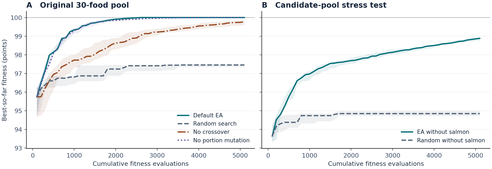
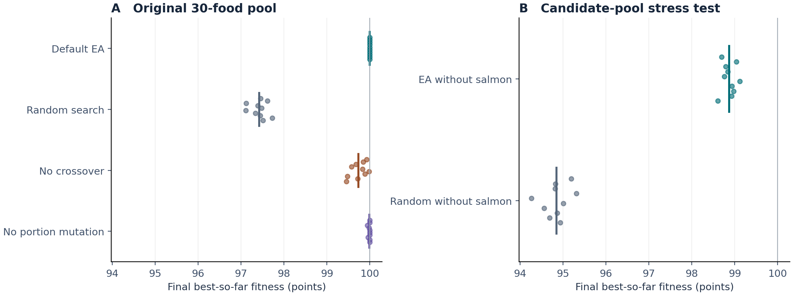

# 4. Experiments and Results

## 4.1 Experimental questions and design

We asked three questions. Does the evolutionary algorithm (EA) outperform independent random sampling when both score the same number of plans? Do whole-module crossover and portion mutation change the search trajectory or the quality of the final plan? How much does the outcome depend on having a vitamin-D-rich ingredient in the candidate pool?

We used the prototype's three-adult household and 30 foods from the bundled Canadian Nutrient File (CNF 2026). The adults share meal components but have individual portions and nutrient targets. Each run scored 100 plans at initialization and 100 in each of 50 subsequent batches, for **5,100 evaluations per run**. The budget includes rescored elites and repeats. It equalizes evaluations, not runtime or distinct plans. Ten fixed seeds (42 and 101–109) across six conditions gave **60 runs and 306,000 evaluations**.

| Condition | Change from the default EA |
|:--|:--|
| Default EA | Four-way tournament selection, two elites, crossover probability 1.0 and portion-mutation probability 0.30 |
| Random search | Sample 100 fresh, structurally valid plans per batch using the same initializer and retain the best seen overall |
| No crossover | Set crossover probability to 0. Instead of recombining the selected parents, copy one before mutation |
| No portion mutation | Set the independent portion-mutation probability to 0. Retain ingredient-kind mutation and crossover |
| EA without salmon | Remove red sockeye salmon (CNF food code 3053) and keep the default EA settings |
| Random without salmon | Use independent random search in the same 29-food pool |

Conditions sharing a food pool and seed start from identical plans. Operators can change subsequent random draws. Removing a food changes initialization too, so the pool comparison is a stress test.

## 4.2 What we measured

The base score averages the adults' weighted adequacy scores. Nutrient points are capped at target. Plans are ranked by tolerable upper intake limit (UL) status, normalized known excess, then penalized fitness. The curves track the best plan by that ranking. All plans had incomplete UL checks and no known exceedance, so fitness equaled base score. We report means and sample standard deviations across seeds. All-target attainment uses the unrounded score with a tolerance of 0.000000001 points. Diversity is the fraction of distinct plan signatures, not ingredient variety.

\newpage

## 4.3 Search trajectories and final scores

{width=100%}

| Condition | Final fitness, mean ± SD | All targets met | Mean final diversity |
|:--|--:|--:|--:|
| Default EA | 100.000 ± 0.000 | 10/10 | 99.9% |
| Random search | 97.420 ± 0.195 | 0/10 | 100.0% |
| No crossover | 99.735 ± 0.187 | 0/10 | 74.0% |
| No portion mutation | 99.988 ± 0.021 | 5/10 | 49.6% |
| EA without salmon | 98.869 ± 0.161 | 0/10 | 99.1% |
| Random without salmon | 94.848 ± 0.302 | 0/10 | 100.0% |

The default EA started from a mean best fitness of 95.533, shared with the three other 30-food conditions. By generation 10 (1,100 evaluations), median best-so-far fitness was 99.380 for the default EA and 96.869 for random search. The EA finished ahead on all ten paired seeds by a mean of **2.580 points**. The first all-target solution appeared between generations 20 and 32, with a median of 25. The final population mean also rose to 99.895, so the result was not driven by one exceptional archived plan. The corresponding mean of the last independent random batches was 85.471.

Removing crossover reduced final fitness by 0.265 points on average, and none of the ten runs met every target. Removing portion mutation barely changed the average endpoint (a loss of 0.012 points) but reduced attainment from ten runs to five. Among the five successful runs without portion mutation, the median first attainment was generation 31. Final diversity also fell to 49.6%, although that figure may partly reflect the loss of new portion values that would otherwise distinguish very similar plans.

\newpage

## 4.4 Candidate-pool stress test and plan quality

{width=100%}

Red sockeye salmon supplies 16.7 µg of vitamin D per 100 g in the bundled data. The next highest candidate is 2% milk at about 1.94 µg per 100 g. Removing salmon reduced the EA endpoint from 100.000 to 98.869. The EA still beat random search without salmon on all ten seeds by a mean of **4.020 points**, but none of the resulting EA plans met every target. All 30 adult-run outcomes in that condition fell below the vitamin D target. On average, the best EA plans provided 73.6% of the target, leaving a 3.96 µg shortfall per adult. The no-salmon random baseline provided 22.7% of the target. The EA mitigated the loss without eliminating it within the tested budget.

**Example winning plan from seed 42.** The three adults each scored 100. The archived menu used white bread as the staple in all three meals and included about 284 g of red sockeye salmon across the household. The detailed JSON lists each component and its individual portions.

| Member | Energy, actual / reference (kcal) | Vitamin D (µg) | Calcium (mg) | Protein (g) |
|:--|--:|--:|--:|--:|
| Adult A | 2,633 / 2,400 | 20.12 | 1,305 | 108.87 |
| Adult B | 2,218 / 2,000 | 16.77 | 1,103 | 91.17 |
| Adult C | 2,011 / 1,800 | 15.09 | 1,002 | 82.32 |

Vitamin D and calcium targets were 15 µg and 1,000 mg for each adult in this model. The three adults met those targets, with Adult C close to both thresholds. Each adult's energy intake nevertheless exceeded their reference value. The vitamin E UL check was unavailable for all three, even though the model could score vitamin E adequacy. The result is a structurally valid, high-scoring plan under the model, not a finding of dietary safety or suitability.

\newpage

# 5. Analysis and Reflection

## 5.1 Search Effectiveness Under a Fixed Evaluation Budget

The results support the expectation that selection and variation improve on independent sampling. The default EA outperformed the matched random baseline on all ten seeds in each food pool, by 2.580 fitness points on average in the original pool and 4.020 without salmon (Sections 4.3 and 4.4). Its population mean also improved, so the gain was not limited to a single archived winner. Both methods scored structurally valid plans. The EA's advantage therefore reflects its ability to improve valid solutions through search, rather than a difference in how invalid menus were handled. The comparison does not establish a runtime advantage or superiority to other optimizers.

## 5.2 Effects of Crossover and Portion Mutation

Removing crossover reduced mean final fitness by 0.265 points and eliminated full target attainment (10/10 to 0/10). Whole-module crossover can combine useful dishes or staples from different parents. With crossover and staple mutation disabled, staple sequences can survive selection but cannot be recombined or changed within a lineage. The experiment did not isolate the contribution of individual crossover modules. Removing portion mutation reduced mean fitness by only 0.012 points, yet attainment fell from 10/10 to 5/10. Thus, crossover had the larger effect on mean fitness in this instance, whereas portion mutation helped close small deficits that the average score can obscure.

## 5.3 Candidate-Pool Sensitivity and Observed Failure Mode

Without salmon, the EA still improved on random search but fell short of the vitamin D target for all 30 adult-run outcomes, reaching 73.6% of target on average. This was a consistent failure of the observed solutions even though mean final fitness remained 98.869. The experiment demonstrates sensitivity to the supplied candidate pool under the tested budget. It does not prove that the restricted pool has no fully adequate solution, since only one food exclusion and one household were tested and no exact feasibility check was performed.

## 5.4 Objective-Function and Data Limitations

Full target attainment is not equivalent to a balanced or fully assessed menu. Across default winning plans, actual energy intake averaged 107.7% of reference, with per-run household mean ratios ranging from 103.4% to 112.3%. The objective does not penalize energy deviation or repetition, and the seed-42 winner used the same staple at every meal. Moreover, none of the 60 winning plans had a known upper intake limit (UL) exceedance, but all 60 had incomplete UL assessment because the applicable vitamin E quantity was unavailable. Consequently, the experiments did not test the trade-off between known UL excess and high adequacy, although the unit tests cover the ranking rule on constructed cases.

## 5.5 Priorities for Further Evaluation

The first priority is to add a penalty for energy deviation and a simple limit on repetition, then measure the trade-off against each adult's nutrient adequacy. The next priorities are to repeat the study across household profiles and food exclusions, compare against a local-search baseline, and construct a case that tests the UL ranking under known exceedances. These tests address observed gaps more directly than further tuning on the same instance, where the default EA already reached the modeled ceiling.

*Reproduction.* Run `python -m experiments.run_experiments` from the project root. The seed list, scoring backend, condition settings and input checksums are recorded in `experiments/results/run_manifest.json`. The full paired data, nutrient outcomes and plot inputs are supplied beside it. See `dataset/README.md` for the Canadian Nutrient File source and licensing.
